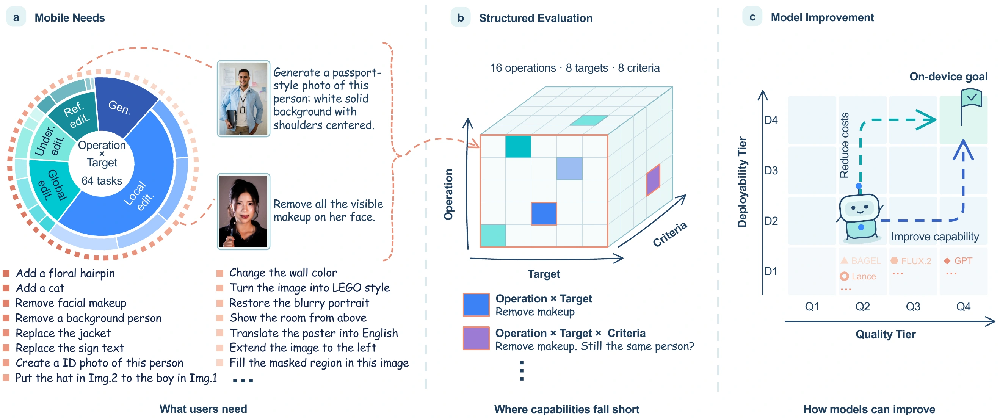

# MoI-Bench

### A Benchmark for Image Models on Mobile Devices

[Project page](https://carlofkl.github.io/MoI-Bench-project/) · [Paper](https://carlofkl.github.io/MoI-Bench-project/assets/paper/MoI-Bench.pdf)

MoI-Bench evaluates image generation and editing through requests people make on mobile devices. It contains **1,150 samples across 64 subtasks**, organized by **16 operations** and **8 target categories**.

**MoI-Eval** uses sample-specific questions to assess instruction following, visual quality and detail preservation. Alongside overall quality, it reports capability profiles by operation, target and criterion. A separate Quality–Deployability map relates reference-model quality to measured mobile latency, storage and memory costs.



## What can you evaluate?

- **Generation:** create images from text prompts.
- **Local editing:** add, remove, replace or adjust selected content.
- **Global editing:** change style, background or viewpoint, and restore image quality.
- **Understanding editing:** perform semantic edits, outpainting and inpainting.
- **Reference editing:** use one reference, or a base image with up to three references.

Targets include concrete and abstract objects, animals, body and limbs, face and hair, clothing and accessories, multiple subjects, and text and documents. Applicable operation–target combinations define the 64 subtasks; the benchmark is not a fully populated Cartesian product.

## Release checklist

This repository currently provides the project introduction and release plan. The runnable package is being prepared; unchecked items are **not yet available here**.

- [x] Project website and qualitative examples
- [x] Paper available through the project website
- [ ] Benchmark metadata, instructions and task taxonomy
- [ ] Data download and validation scripts, with image-source attribution
- [ ] Reviewed evaluation rubrics and sample-level questions
- [ ] Model inference adapters and output-format documentation
- [ ] MoI-Eval judging and score-aggregation scripts
- [ ] Capability-profile plotting tools
- [ ] Mobile deployment configurations and measurement instructions

## Using the benchmark

> **Release preview:** the steps below describe the existing development workflow. Scripts, metadata, reviewed questions and dependency instructions have not yet been published in this repository. The commands become usable when those checklist items are released. Legacy `moge` filenames are retained in these examples to match the current implementation.

### 1. Get the repository and download the data

```bash
git clone https://github.com/Carlofkl/MoI-Bench.git
cd MoI-Bench
```

Once the download package is released, install its image-processing dependency and provide your own Pexels API key. The downloader reconstructs benchmark inputs from the recorded source metadata.

```bash
python -m pip install Pillow
export PEXELS_API_KEY="YOUR_PEXELS_API_KEY"

# Inspect planned downloads first.
python scripts/download_moge_images.py --dry-run

# Download and reconstruct the benchmark inputs.
python scripts/download_moge_images.py

# Validate metadata, image paths and dimensions.
python scripts/validate_moge.py --verify-images
```

Use the released image-source and license records for attribution. Keep API keys outside version control.

### 2. Generate model outputs

Install the selected model's dependencies and obtain its checkpoint according to the inference instructions that will accompany the release. GPU memory requirements depend on the model.

For example, the development package provides separate DreamLite generation and editing runners:

```bash
python scripts/run_dreamlite_gen.py --dry-run --limit 3
python scripts/run_dreamlite_edit.py --dry-run --limit 3

python scripts/run_dreamlite_gen.py
python scripts/run_dreamlite_edit.py
```

These commands illustrate the workflow, not a claim that the runner defaults reproduce every configuration reported in the paper. Use the released experiment configurations for reproduction.

Outputs follow this layout:

```text
output/<model_tag>/<full_task>/<sample_id>/
├── prompt.json
├── output_sizes.json
└── seed_0.png
```

`prompt.json` links each output to its benchmark entry and ordered input images. MoI-Eval evaluates one output per sample, using `seed_0.png`. A custom model should follow the same output contract and declare unsupported input configurations.

### 3. Evaluate output quality

The evaluator requires the released sample-level questions and credentials for the selected judge. For an OpenAI-compatible evaluation using GPT-4o:

```bash
export OPENAI_API_KEY="YOUR_OPENAI_API_KEY"

python scripts/eval_vlm_judge.py \
  --model-tag dreamlite \
  --judge openai \
  --judge-model gpt-4o \
  --judge-tag gpt-4o \
  --mode all
```

Judge calls incur provider charges. Keep the judge configuration fixed when comparing models. Questions use the same `0`, `0.6` and `1` scoring anchors; unsupported tasks must remain distinguishable from execution failures and missing outputs.

### 4. Aggregate and inspect results

```bash
python scripts/aggregate_scores.py \
  --mode all \
  --judge-tag gpt-4o \
  --models dreamlite
```

Inspect overall quality, task coverage and the operation-, target- and criterion-level profiles. These show both what a model supports and where its outputs fall short. Quality scores alone do not establish on-device performance: latency, storage and peak memory require separate measurements on the target device.

## Citation

The BibTeX entry will be added when the publication metadata is finalized.

## Authors

Kailai Feng<sup>1,*</sup>, Haoxiang Rao<sup>2,*</sup>, Yuxiang Wei<sup>3,†</sup>, Bo Chen<sup>2</sup>, Junsong Li<sup>2</sup>, Yang Pan<sup>2</sup>, Chengkun Cai<sup>1</sup>, Jagmohan Chauhan<sup>1,†</sup>

<sup>1</sup> University College London · <sup>2</sup> ByteDance · <sup>3</sup> The Hong Kong Polytechnic University

<sup>*</sup> Equal contribution. <sup>†</sup> Co-corresponding authors.
